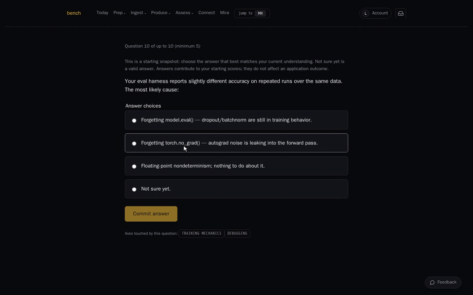
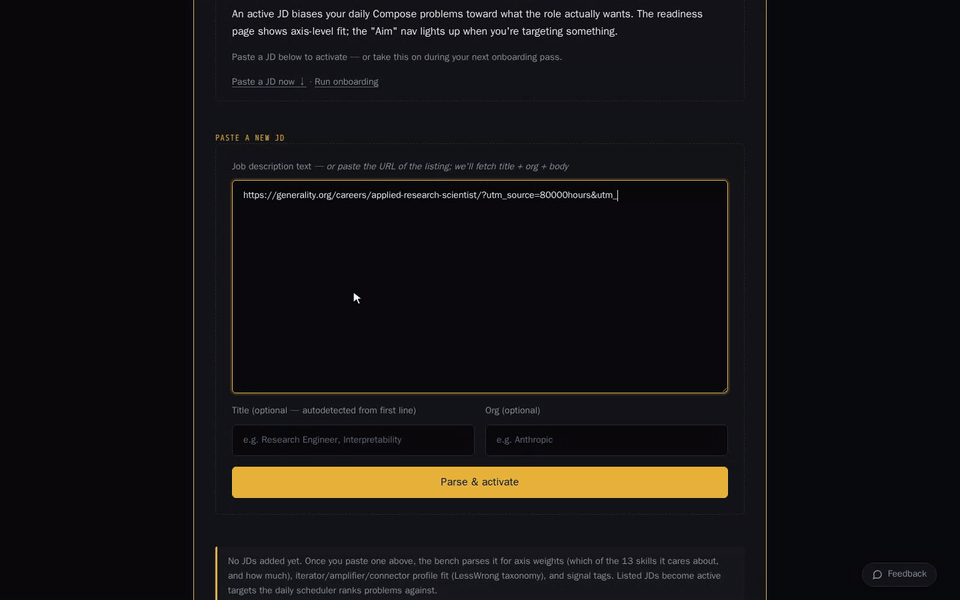
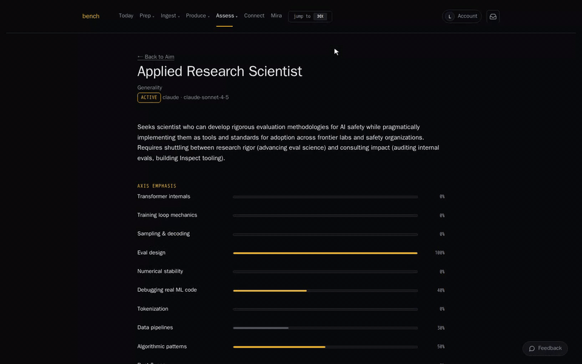
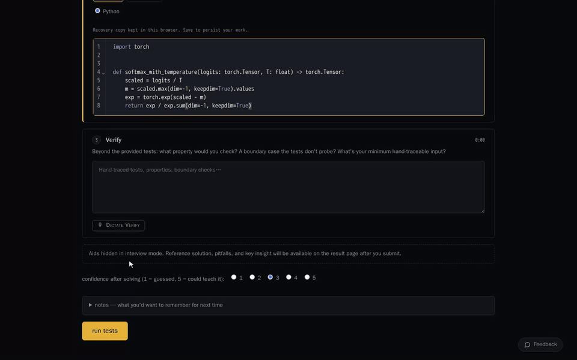

# Bench

Bench is a practice environment for engineers moving into AI safety
research engineering. It drills the work those roles actually involve:
implementing transformer components from scratch, finding bugs that
only show up at eval time, reproducing results from papers, and
explaining your reasoning out loud.

It is not general software-interview prep. The problems assume you can
already code and focus on the ML engineering that safety teams need.

Bench is part of [PACT](https://github.com/pact-safety), which builds
open-source research infrastructure, diagnostic tools, and practice
environments so independent researchers can evaluate AI systems for
themselves.

## What a session looks like

These are recordings of the real app at normal speed, with a test user.
The analysis and review shown are live model output.

A short assessment maps you across five skill axes:



Paste a job posting and bench reads what the role needs:



Today's plan shifts toward the gaps, mixing papers, videos, and exercises:



Interview mode hides the aids, runs the real tests, and reviews each
phase of how you worked:



## What's in it

- **47 problems.** 38 build-from-scratch tasks (attention, layer norm,
  sampling, KV cache, BPE, training-loop mechanics, eval scoring), 8
  debug-and-fix tasks, and 1 code-reading task. Each is sized so that
  someone in practice solves it in interview time, and someone out of
  practice doesn't.
- **52 short exercises and 12 warmups** in Python and Rust, for days
  when a full problem is too much.
- **Tracks** that follow public curricula: ARENA, MATS, ML4Good
  prework, a first pass at mechanistic interpretability, and DS&A
  fundamentals.
- **A scheduler** that decides what you work on next from your own
  history. The weights live in `config.toml` and can be changed
  without a migration.
- **Feedback on your attempts** from an LLM reviewer, plus hints and
  weekly reflection prompts built from what you actually did that
  week. The app runs without an API key: hints fall back to fixed
  prompts and review is skipped. You can also bring your own key.

## Theory of change

Frontier AI capability is concentrating in a few organizations. The
inputs are compute, capital, model access, state relationships, and
talent. Bench works on talent.

The people who can do hands-on safety engineering (building evals,
reproducing papers, reading model internals) are mostly trained and
hired inside frontier labs. The bodies meant to check those labs need
the same skills: AI safety institutes, independent evaluators, auditors,
academic groups, and nonprofit research orgs. They hire from a thin
pool. A check only holds if the body using it has the technical
capacity to evaluate what it is checking.

Bench lowers the cost of reaching that capacity outside a lab:

1. It's free, open source, and self-hostable, so nobody needs a lab
   affiliation or a bootcamp seat to use it.
2. Practice targets the specific skills these roles hire for, with
   feedback and spaced repetition rather than one-off problem sets.
3. More people reach working competence. More of them can staff
   external evaluation and oversight. Those bodies are more likely to
   catch and contest problems when it matters.

What this assumes, and how it could be wrong:

- **Skill is a binding constraint.** If the real bottleneck is funded
  roles, faster training helps little.
- **People go where the checks are.** Trained engineers may still go
  to frontier labs, which adds to the concentration this is meant to
  offset. The tracks lean toward evaluation and interpretability work,
  but that tilts the odds without controlling them.
- **There's no outcome data yet.** Bench is in alpha with a small
  invite-only cohort. The measure that would test this is where users
  end up working, and that hasn't been collected.

## Running it locally

You need Python 3.11+ and a Postgres database (a local one or a
Supabase project).

```sh
./scripts/setup.sh
```

The script copies `.env.example` to `.env`, installs dependencies, and
runs migrations if `DATABASE_URL` is set. Then start the app:

```sh
LIS_LOCAL_MODE=1 .venv/bin/uvicorn app.main:app --port 8765
```

`LIS_LOCAL_MODE=1` skips GitHub OAuth for single-user local use. Open
<http://127.0.0.1:8765/>. [`SETUP.md`](SETUP.md) covers Supabase, auth,
and API keys.

To see the app with realistic data without solving problems by hand,
seed a mock user:

```sh
.venv/bin/python scripts/mock_user.py --persona grinder --reset
```

## Stack

FastAPI, Jinja2 templates, and HTMX, backed by Postgres. There's no
SPA and no required build step. A few Svelte components add
interactivity where it helps, and the app works without them.

## Documentation

`mkdocs serve` (after `pip install -e ".[docs]"`) serves the full docs
at <http://127.0.0.1:8000/>: how practice works, what data is stored,
accessibility, the architecture, and the roadmap. [`SPEC.md`](SPEC.md)
records the implementation decisions.

## Status

Alpha. A hosted instance runs invite-only. The exercise runner doesn't
yet isolate submitted code; see [`SECURITY.md`](SECURITY.md) before
running this for anyone you don't trust.

## Contributing

See [`CONTRIBUTING.md`](CONTRIBUTING.md). Report security issues
privately as described in [`SECURITY.md`](SECURITY.md).

## License

MIT. See [`LICENSE`](LICENSE).
